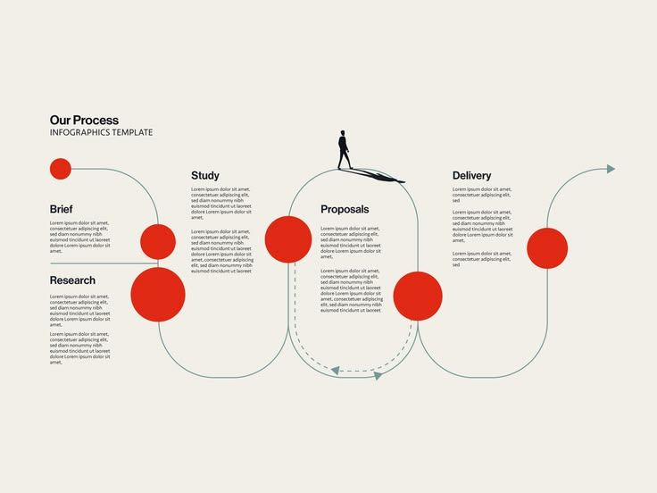

# CASE-0002｜Our Process：曲线式反馈流程信息图

> **入库日期：** 2026-11-23  
> **图片核验：** 原图 PNG，736 × 552 像素，字节与用户提供的图片一致（Git blob SHA `d154ef40e62b16675a02e1b8f56983e64b8fd1ba`）。  
> **基础类型：** 编年型（阶段／顺序），不是“时间轴型”。  
> **表现标签：** 05 流程图型 Process Infographics。  
> **设计方法标签：** 不标 ISOTYPE（图中行走人物并非可复用的统计象形符号系统）。

## 案例材料

- [原始图像：原图.png](./原图.png)
- [独立分析文档：分析.md](./分析.md)
- [基础数据集：基础数据集.csv](./基础数据集.csv)（5 条可辨识阶段记录）
- [流程关系：流程关系.csv](./流程关系.csv)（示意推进与回返关系）
- [视觉标记：视觉标记.csv](./视觉标记.csv)（6 个红色圆形的位置与尺寸，图像提取）
- [数据字典：数据字典.md](./数据字典.md)（字段、口径、来源与可复核性）
- [原图来源与版权状态：原图来源.md](./原图来源.md)

## 简要发现

**主序列 + 局部反馈回路**：五个阶段标题以顺序逻辑组织；曲线、节点、回返箭头与行走人物构成空间化过程叙事。红色圆大小不代表任何可验证的数量，背景正文为 Lorem ipsum 占位文本。原图无日期、时长、数量标尺或统计量。

**图片来源：** 用户在本次对话提供的图片。原作者、首发链接和公开再发布许可尚待核实，见来源文档。

[返回流程图案例目录](../README.md)｜[返回全库索引](../../../案例索引.md)
