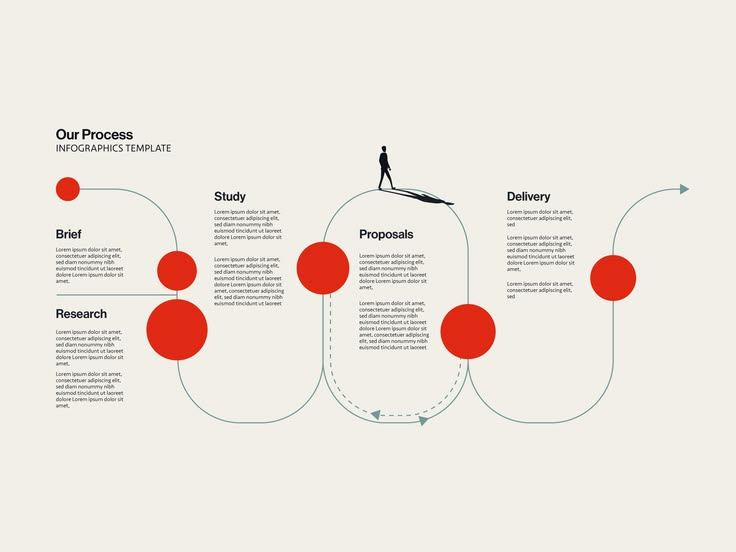

# CASE-0002｜Our Process 曲线式反馈流程信息图：独立分析

> **核心结论：** 本图将**单一阶段顺序**转写为**连续起伏曲线 + 红色节点 + 局部虚线回返**的过程叙事。其设计核心是空间化编排和视觉节奏，而不是基于数值的统计可视化。

## 案例元数据与证据等级

- **图面标题：** `Our Process`；副标题：`INFOGRAPHICS TEMPLATE`。
- **原图规格：** 736 × 552 px，约 4:3 横向；图像保存为原始 PNG，SHA-256 与 `数据字典.md` 一致。
- **来源：** 用户在本对话提供并要求上传；未核实原作者、首发网站、发布许可，详见 [原图来源.md](./原图来源.md)。
- **分析日期：** 2026-11-23。
- **证据分层：** 阶段标题、节点数、形态、方向箭头和占位文本是**图面观察**；抽象的流程关系是**解释性推断**；圆心与外接框是**像素计算**，非原作提供的业务值。

## 类型学归属

| 判断层 | 结论 | 依据 |
|---|---|---|
| **01 唯一基础类型** | **编年型（顺序／过程）** | 五个阶段依次展开，有主要前进顺序与可见的局部回返；“编年”不以日期为必要条件 |
| **02 主表现标签** | **05｜流程图型 Process Infographics** | 连续线路、阶段节点与局部回返路径组织工作过程 |
| 02 辅助表现标签 | 不另设 | 没有可证明的时间比例刻度，也不是按类别组织的清单 |
| 02 方法标签 | **不标 ISOTYPE** | 单个行走人物是隐喻性装饰，不是标准图符词汇、重复单位或象形统计体系 |
| 03 统计图形 | **无定量统计图形** | 无定量变量、比例尺、图例或数值标签；圆形面积不能当作气泡图数值 |

**排除说明：** 不属于严格的 Timeline，因为没有时间字段；也不是层级图、编目图、地理图或字母索引。以实际连续过程为主，而非几类信息并列。

## A｜底层数据逻辑

### A1. 可见阶段与有序关系

图面可直接辨认五个英文阶段名：**Brief → Research → Study → Proposals → Delivery**。这条阅读顺序是依据布局与主要路线的**推定排序**，而非原文提供的时间/业务依赖证据。

六个互不相交的红色圆形由左向右分布，尺寸不同；其中两个位于大致相同的横向位置但高低不同。右侧终点有灰绿色箭头；中部两个大节点之间，一段虚线弯道含左向箭头，与主线中的右向箭头形成**局部回返/迭代**的视觉提示。

### A2. 三项判据

1. **单向性（主导成立）：** 大路径整体由左至右推进，但局部允许反向连接；不是严格单向无环图。
2. **低维度（成立）：** 主导信息关系是一个阶段顺序维度，其他信息只是节点说明与局部反馈。
3. **不可逆性（有限成立）：** 不可随意打乱作为“过程”呈现的阶段次序；但图形明确展示返程，**不能**据此声称业务过程绝对不可逆。

### A3. 关系结构

抽象为 `S01 → S02 → S03 → S04 → S05` 的主序列和 `S04 ⇢ S03` 的**图形层面回返关系推断**。具体线段的作者业务含义未说明，故此关系不构成真实项目的已验证流程规范。

## B｜统计图形和计算

- **没有**量化横轴/纵轴、时长、比例、金额、频率、地理坐标或与圆面积对应的指标。
- 红色圆形大小差异为视觉组织与节奏，**不标注为大小编码（bubble size）**。
- 曲线弯折、弧长和相邻间距不代表阶段时长或变化幅度。
- 可以进行**结构计算**（五阶段、六个红色圆标记、一个有局部回返的主流程），但不开展虚构的定量统计。
- 对红圆的像素位置与范围进行了实际图像测量，详见 [视觉标记.csv](./视觉标记.csv)；这是作品形态数据而非其主题源数据。

## C｜视觉编码与设计表达

| 元素 | 图面观察 | 传达作用 | 约束 |
|---|---|---|---|
| 点 | 6 个不同大小的朱红实圆 | 节点停顿、视觉锚点、节奏变化 | 大小无数量图例，不得读作统计规模 |
| 线 | 低饱和灰绿色细曲线；中部虚线 | 主流程、返程与行进方向 | 实线和虚线的语义宜在再设计时明确标注 |
| 面 | 暖米白色底与大面积负空间 | 分配说明区，减小视觉噪声 | 负空间仅作组织，不表示数据区间 |
| 体 | 无三维统计对象 | 不承担数据语义 | 人物阴影属于视觉修辞 |
| 图像/符号 | 上方黑色行走人物及其投影，终点和底部方向箭头 | 将过程转译为“人在路径上前进”的旅程隐喻 | 人物非图符统计单位 |
| 色彩 | 暖米白 `#F2EFE8`、朱红近似 `#E02A15`、灰绿色导线、黑文字 | 背景/节点/主轴/信息的职能分离 | 近似取样色，非作者设计规范 |
| 排版/字体 | 无衬线黑色阶段标题；小字号英文多行说明，跨曲线空白区错位排布 | 标题优先，说明其次，路径串联阅读 | 小字可读性弱；正文为无真实语义的 Lorem ipsum |

**核心形式语言：** 横向延展、纵向曲率变化、曲线将文字内容切分到不同的上/下空间、非等比圆形建立视觉重音、二维留白中插入极少量具象象征。

## D｜基础数据与信息架构

独立保留三张表，遵守**一行一个最小记录、一列一个原子字段、单元格单值**。

1. **[基础数据集.csv](./基础数据集.csv)：** 5 行 × 3 列（不含表头），一行为一个可辨认的阶段名；`stage_id`、`order_key`、`stage_name`。
2. **[流程关系.csv](./流程关系.csv)：** 5 行 × 5 列，一行为一条主流程或反馈关系，关联于 `stage_id`，附证据类型标记。
3. **[视觉标记.csv](./视觉标记.csv)：** 6 行 × 6 列，一行为一个可见红圆标记，存储图像检测出的二维质心与外接框尺寸。坐标以原始图像左上角为起点，仅供版式分析。

正文段落均是 Lorem ipsum，占位文字不能作为真实的阶段任务、原因、结果或绩效数据。数据表没有编造时间字段或定量指标。

## E｜视觉叙事架构

- **入口：** 左上方 `Our Process` 与起始红圆。
- **主线：** 沿绿色线路、阶段标题、红圆节点组织连续过程。
- **视觉节拍：** 曲线升降周期与不等尺寸圆形让阅读发生加速/停顿；这是一种形式修辞而非真实时长。
- **修正机制：** 中部实线右向箭头和虚线左向箭头并置，引导读者认识到阶段之间可能存在回看或迭代。
- **终点：** 右侧灰绿箭头超出最后一个红圆，象征流程向外结束或继续。
- **叙事隐喻：** 行走人物把抽象的线转化为可行进的道路；不是分镜叙事，也不等于统计信息。

## 可复用的设计方法（重建流程，非作者工序）

1. **确定过程关系：** 先建立唯一主序列，并单独确定反馈边；不用曲线形状代替事实上的阶段关系。
2. **建构字段：** 整理阶段表、关系表、可选的内容字段和来源口径；各字段保持原子性。
3. **画主路径：** 选择直线或连续贝塞尔曲线，确保前后方向可读；必要时在方向转折处加入箭头。
4. **分配节点和文字：** 阶段节点沿路径定位，标题和文本错落分布在曲线两侧；控制局部拥挤与遮挡。
5. **配置视觉编码：** 统一背景、导线、节点、文字的职能色；如节点面积并非数量，明确作为装饰性权重。
6. **加入反馈连接：** 通过虚线、箭头、路径样式或文字标记，区分回返与主线；不要制造无法证明的因果解释。
7. **增加叙事性符号：** 可选行走人物或与主题相符的少量视觉隐喻，但不让装饰盖过信息。
8. **校验成品：** 核查阶段顺序、箭头方向、数据来源、文字层级、颜色对比、最小字体和版权。

## 设计问题与改进方向

**有效之处：** 识别速度快，曲线连续性好，利用空间起伏调节视觉节奏；节点、文字与留白的相互依存很强。

**需修订之处：** 字体尺寸过小；部分阶段文本与圆的位置关系不够明确；局部回返缺乏说明；红圆直径差异可能让人误以为是业务量；占位文案无法传达真实业务语义。

**泛化原则：** 连续的视觉引导线可以承担主叙事顺序，节点负责停顿与重点，回返边负责修正；这些形式可用于跨主题的过程信息图，但不能脱离实际数据关系直接套用。

## 理论回写位置

- [01｜编年型信息图形概念定义](../../../../01-信息图形数据逻辑/01-编年型信息图形概念定义.md)：支持“无时间字段的顺序流程”和“允许局部反馈而不称严格不可逆”。
- [02｜流程图型标签说明](../../00-标签说明.md)：作为具体曲线流程、非定量节点与回返路径的已核验案例。
- [全库案例索引](../../../案例索引.md)。

**版权提示：** 图像已按照用户明确要求归档为原始 PNG，原作者与公开再发布许可尚待核实；不因保存在公开仓库中就推定作品可任意复制。
